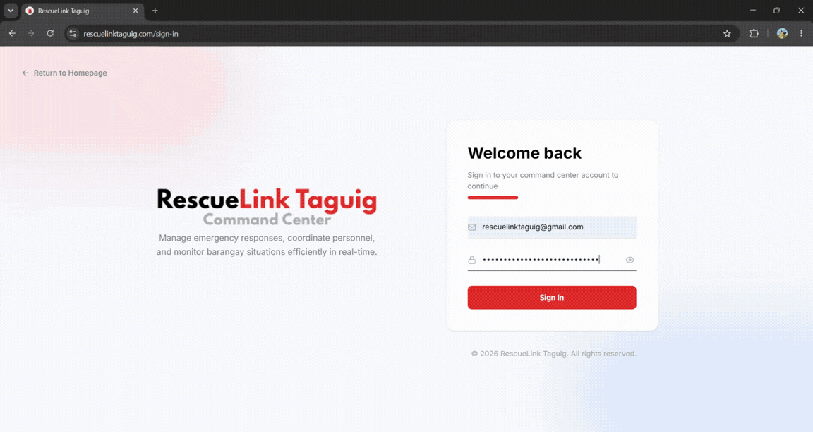
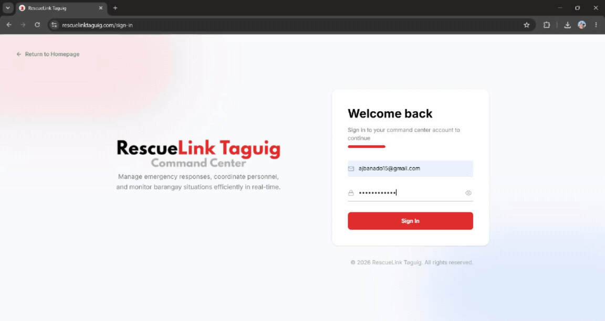
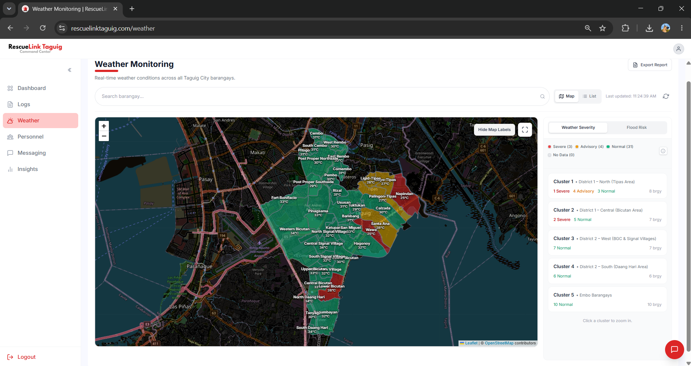
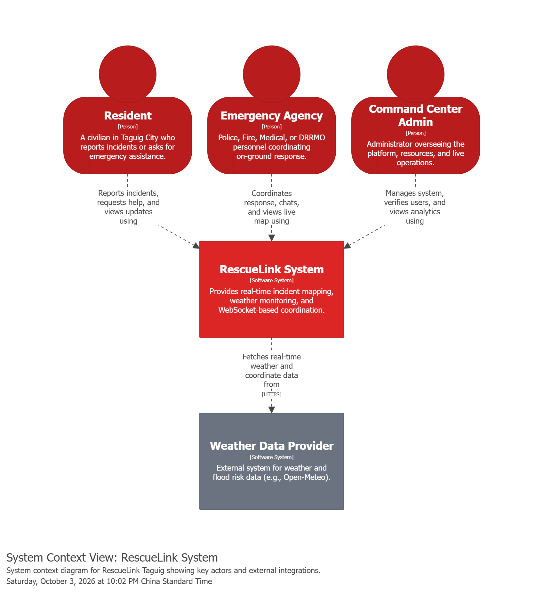
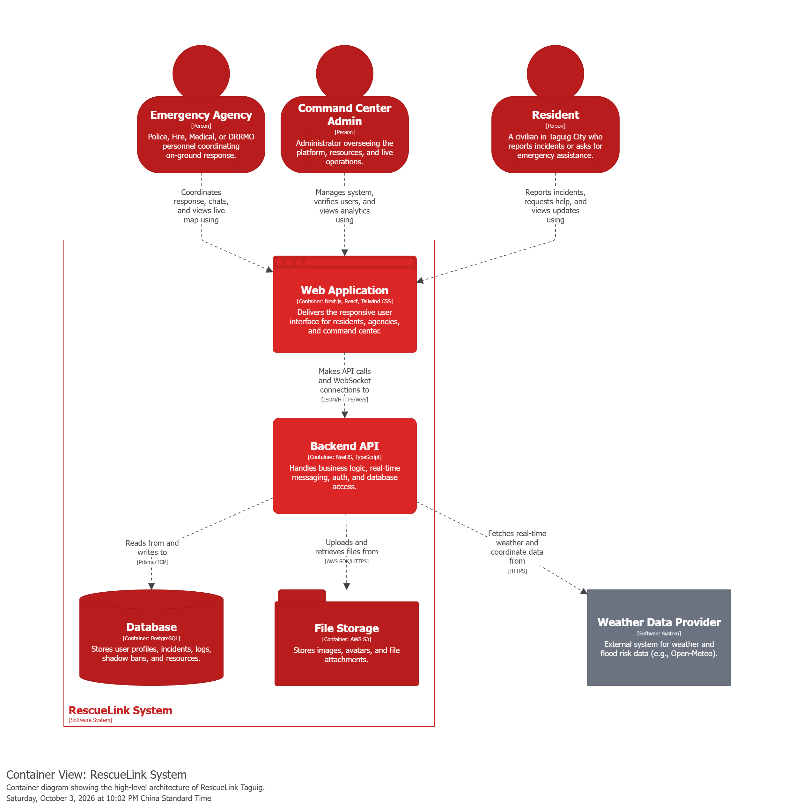
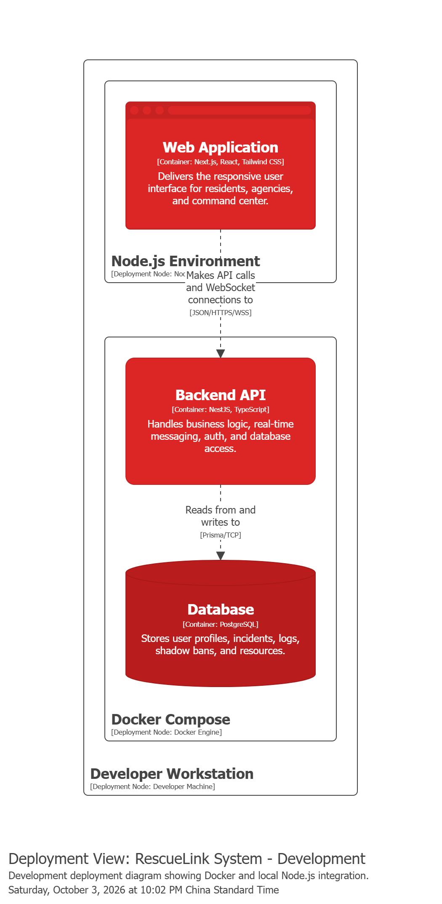
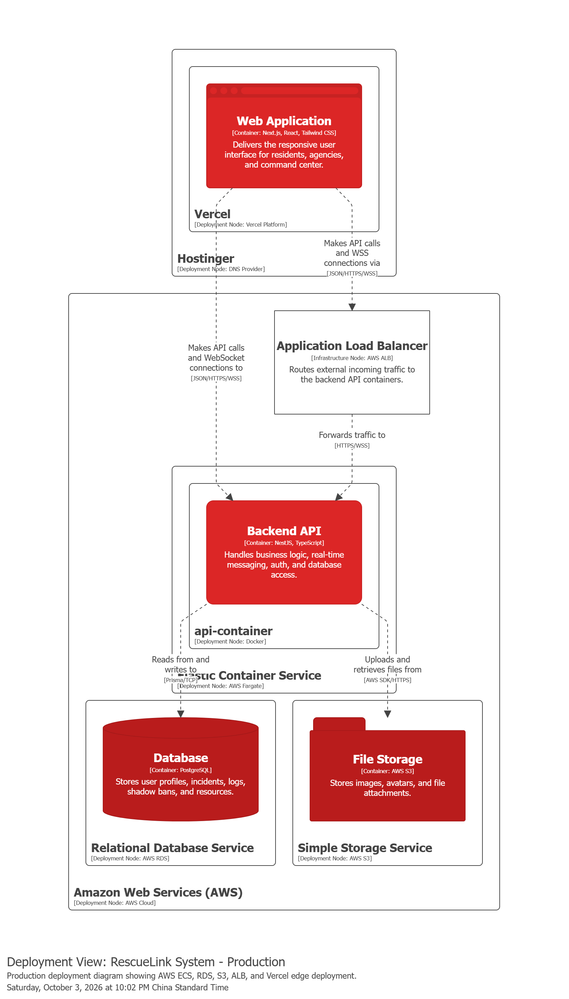
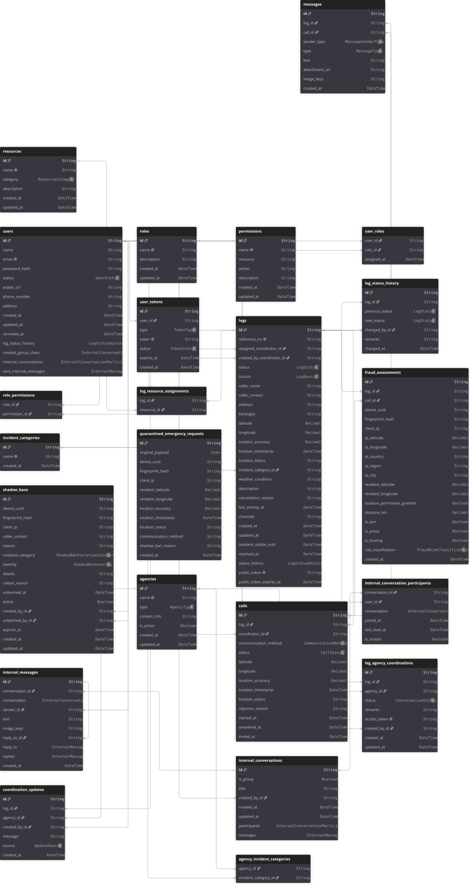

<div align="center">

# RescueLink Taguig

**Emergency response, incident logging, and agency coordination platform for the Command Center of Taguig.**

Built by **Arjohn Banado** (Project Lead) · **John Lawrence Amihan** · **Mark Dennis Concha** · **Bob Geof Tortogo**

[**Live Site**](https://rescuelinktaguig.com) · [Team](#team) · [Architecture](#architecture) · [Getting Started](#getting-started) · [Documentation](#documentation)

<br />


<br />


</div>

---

## Table of Contents

- [Overview](#overview)
- [Team](#team)
- [Showcase](#showcase)
- [Key Features](#key-features)
- [Tech Stack](#tech-stack)
- [Architecture](#architecture)
- [Cloud Deployment](#cloud-deployment)
- [Repository Structure](#repository-structure)
- [Getting Started](#getting-started)
- [Testing & CI](#testing--ci)
- [Documentation](#documentation)
- [Acknowledgements](#acknowledgements)
- [License](#license)

---

## Overview

RescueLink Taguig connects **Taguig City residents** directly with the **Command Center of Taguig**. Residents can request help through live voice, video, or chat from any browser. Command Center coordinators triage each request, log the incident, pinpoint its location, and coordinate the response with partner agencies (Police, Fire, Medical, DRRMO), all from one real-time workspace.

| | |
| :-- | :-- |
| **Client** | Command Center of Taguig |
| **Users** | Residents, Command Center Coordinators, Administrators |
| **Status** | In production at [rescuelinktaguig.com](https://rescuelinktaguig.com) |

---

## Team

| Member | Role |
| :-- | :-- |
| **Arjohn Banado** | Project Lead, UI/UX Design, Full-Stack Development, Cloud Architecture, CI/CD |
| **John Lawrence Amihan** | Frontend Development, Backend Development, Documentation |
| **Mark Dennis Concha** | Backend Development, Documentation |
| **Bob Geof Tortogo** | Backend Development, Documentation |

---

## Showcase

<div align="center">


<p><em>Command Center workflow: receiving, triaging, and logging an emergency</em></p>

<br />


<p><em>Resident emergency live calling over WebRTC voice and video</em></p>

<br />


<p><em>Real-time incident map and coordination dashboard</em></p>

</div>

---

## Key Features

| Feature | Description |
| :-- | :-- |
| **Emergency Live Calling** | Residents reach the Command Center through peer-to-peer voice, video, or chat, with automatic call routing to available coordinators. |
| **Incident Logging** | Every call creates an emergency log with auto-saving caller details, incident category, requested needs, status tracking, and shareable read-only links. |
| **Real-time Incident Mapping** | Live resident geolocation, boundary enforcement for Taguig City, and an interactive map for pinning and editing incident locations. |
| **Agency Coordination** | Track dispatched agencies and post coordination updates on each incident. |
| **Weather & Flood Risk Monitoring** | Barangay-level weather and flood risk clusters from live forecast data, with PDF report export. |
| **Insights Dashboard** | Incident heatmaps, category trends, and coordinator workload analytics. |
| **Internal Messaging** | Real-time chat between Command Center personnel. |
| **Fraud Prevention** | Device fingerprinting, IP geolocation checks, rate limiting, and shadow bans for abusive callers. |
| **Role-Based Access Control** | Granular `resource:action` permissions enforced on both API endpoints and UI views. |

---

## Tech Stack

| Layer | Technologies |
| :-- | :-- |
| **Frontend** | Next.js 16 (App Router), React 19, TypeScript, Tailwind CSS v4, custom design system |
| **Forms & Validation** | React Hook Form, Zod (shared schemas in `packages/shared-schemas`) |
| **Maps & Geospatial** | Leaflet, React-Leaflet, Turf.js, GeoJSON |
| **Data Visualization** | Recharts, jsPDF (report export) |
| **Backend** | NestJS 11, Node.js, TypeScript, class-validator |
| **Real-time** | Socket.IO (signaling, live updates, messaging), WebRTC with Metered STUN/TURN relays |
| **Database** | PostgreSQL 17, Prisma ORM 7 |
| **Auth & Security** | JWT in HTTP-only cookies, bcrypt, RBAC guards, `@nestjs/throttler`, FingerprintJS |
| **Integrations** | Amazon S3 (media), Resend (email), Open-Meteo (weather) |
| **Testing** | Jest, React Testing Library, Supertest, Playwright |
| **Tooling** | npm workspaces, Docker Compose, ESLint, Prettier, GitHub Actions |

---

## Architecture

RescueLink Taguig is an npm workspaces monorepo. The Next.js web app talks to the NestJS API over REST for data and over Socket.IO for real-time events and WebRTC signaling. Media streams flow peer-to-peer between resident and coordinator, falling back to a TURN relay when a direct connection isn't possible.

Diagrams follow the [C4 model](https://c4model.com/) and are generated from [`docs/architecture/workspace.dsl`](docs/architecture/workspace.dsl) using Structurizr.

<details open>
<summary><strong>System Context</strong></summary>
<br />

</details>

<details>
<summary><strong>Containers</strong></summary>
<br />

</details>

<details>
<summary><strong>Local Development Deployment</strong></summary>
<br />

</details>

---

## Cloud Deployment

| Component | Service | Role |
| :-- | :-- | :-- |
| **Frontend** | Vercel | Hosts the Next.js app on a global edge network |
| **DNS** | Hostinger | Domain and DNS for `rescuelinktaguig.com` |
| **Load Balancer** | AWS Application Load Balancer | Terminates HTTPS and routes traffic to API containers |
| **API Runtime** | AWS ECS on Fargate | Runs the containerized NestJS API without managing servers |
| **Container Registry** | Amazon ECR | Stores the production API Docker images |
| **Database** | Amazon RDS for PostgreSQL | Managed database in a private subnet |
| **Object Storage** | Amazon S3 | Stores incident media and attachments |
| **Media Relay** | Metered TURN | Relays WebRTC streams when peers can't connect directly |

<details open>
<summary><strong>Production Deployment Diagram</strong></summary>
<br />

</details>

---

## Repository Structure

```text
rescue-link-taguig/
├── apps/
│   ├── api/                  # NestJS REST + WebSocket API, Prisma schema, migrations, seeds
│   └── web/                  # Next.js frontend (feature-based structure under src/features)
├── packages/
│   ├── shared-schemas/       # Zod schemas shared by web and api
│   ├── shared-constants/
│   └── shared-utils/
├── docs/
│   ├── api/                  # OpenAPI specification
│   ├── architecture/         # Structurizr DSL and C4 diagrams
│   └── database/             # DBML schema and ERD
├── .github/workflows/        # CI pipeline
└── docker-compose.yml        # Local PostgreSQL + API
```

---

## Getting Started

### Prerequisites

- **Node.js** 20 or later (CI runs on Node 24)
- **npm** 10 or later
- **Docker** and **Docker Compose**

### 1. Clone and install

```bash
git clone https://github.com/emergencyadmincenter/rescue-link-taguig.git
cd rescue-link-taguig
npm install
```

### 2. Configure environment variables

Create a `.env` file in the repository root (used by Docker Compose and Prisma) and an `.env.local` file in `apps/web`.

<details>
<summary><strong>Root <code>.env</code></strong></summary>

| Variable | Description |
| :-- | :-- |
| `NODE_ENV` | `development` or `production` |
| `DB_USER`, `DB_PASSWORD`, `DB_NAME`, `DB_PORT`, `DB_HOST` | Local PostgreSQL credentials |
| `DATABASE_URL` | PostgreSQL connection string used by Prisma |
| `JWT_SECRET` | Secret for signing access tokens |
| `THROTTLE_DEFAULT_TTL`, `THROTTLE_DEFAULT_LIMIT` | Global rate limit window and request count |
| `THROTTLE_AUTH_TTL`, `THROTTLE_AUTH_LIMIT` | Stricter rate limit for auth endpoints |
| `RESEND_API_KEY`, `RESEND_FROM_EMAIL` | Resend credentials for transactional email |
| `FRONTEND_URL` | Base URL of the web app (used in email links) |
| `ALLOWED_ORIGINS` | Comma-separated CORS origins |
| `ADMIN_EMAIL`, `ADMIN_PASSWORD` | Seeded administrator account |
| `AWS_REGION`, `AWS_ACCESS_KEY_ID`, `AWS_SECRET_ACCESS_KEY` | AWS credentials for S3 |
| `AWS_S3_BUCKET_NAME`, `AWS_S3_PRIVATE_BUCKET_NAME` | Public and private S3 buckets |

</details>

<details>
<summary><strong><code>apps/web/.env.local</code></strong></summary>

| Variable | Description |
| :-- | :-- |
| `NEXT_PUBLIC_API_URL` | API base URL, e.g. `http://localhost:3001` |
| `NEXT_PUBLIC_TURN_USERNAME`, `NEXT_PUBLIC_TURN_CREDENTIAL` | Metered TURN credentials for WebRTC |

</details>

### 3. Start the backend

```bash
npm run dev:backend
```

This starts PostgreSQL and the API in Docker. On startup, the API container generates the Prisma client, applies migrations, and seeds the database automatically.

### 4. Start the frontend

```bash
npm run dev:frontend
```

| Service | URL |
| :-- | :-- |
| Web app | http://localhost:3000 |
| API | http://localhost:3001 |
| PostgreSQL | `localhost:5432` |

> [!TIP]
> `npm run dev` runs steps 3 and 4 in sequence.

---

## Testing & CI

```bash
npm run test --workspace=apps/api   # Backend unit tests (Jest)
npm run test --workspace=apps/web   # Frontend component tests (Jest + React Testing Library)
```

Every pull request to `main`, `testing`, or `development` runs the [CI workflow](.github/workflows/ci.yml), which executes the backend and frontend test suites in parallel.

---

## Documentation

| Document | Source | Tool |
| :-- | :-- | :-- |
| C4 architecture diagrams | [`docs/architecture/workspace.dsl`](docs/architecture/workspace.dsl) | Structurizr |
| Database schema (ERD) | [`docs/database/erd.dbml`](docs/database/erd.dbml) | dbdiagram.io |
| REST API specification | [`docs/api/openapi.yaml`](docs/api/openapi.yaml) | OpenAPI 3.0 / Swagger UI |

<details>
<summary><strong>Entity-Relationship Diagram</strong></summary>
<br />

</details>

---

## Acknowledgements

**Design & modeling:** Figma, Canva, Structurizr, dbdiagram.io, Swagger UI

**AI-assisted development:** This project used AI tools to speed up development while every change was reviewed by the team.

| Tool | Used for |
| :-- | :-- |
| Claude | Debugging, feature feasibility analysis, testing strategy, code generation |
| Gemini | Boilerplate generation, image creation, content editing |
| ChatGPT Codex | Architecture research and technical discussions |
| Recraft.ai | Media conversion and editing |

---

## License

This project is proprietary and was developed for the Command Center of Taguig. All rights reserved.

<div align="center">
<br />
<sub>RescueLink Taguig · Empowering rapid response and community safety.</sub>
</div>
